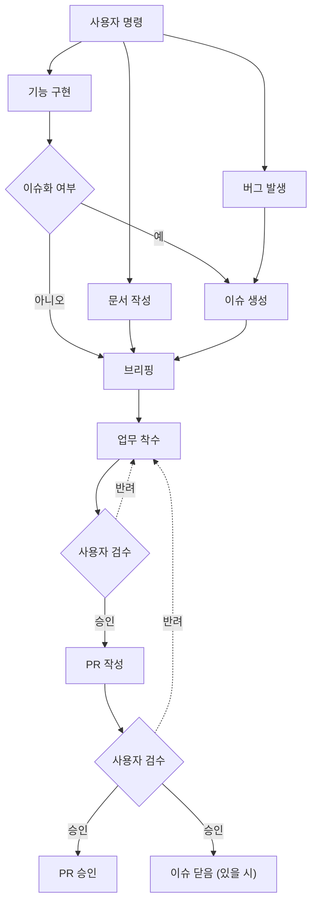

# WorkFlow 규칙

> Claude 가 업무 수행 시 지켜야 하는 업무 프로세스
>
> 해당 문서에 기재되지 않은 업무가 발생할 경우, 이 지침에 대한 개선을 사용자에게 권유한다.

---

## 0. 전체 흐름

- 모든 업무는 아래 흐름을 따른다. 단계를 건너뛰지 않는다.
- 업무에 착수할 때에는 기존 문서와 이 다이어그램을 참고한다.



## 1. 사용자 명령

- 명령을 받으면 `기능 구현`, `버그 발생`, `문서 작성` 중 하나로 분류하고, 응답 첫 줄에 분류 결과를 밝힌다.
- 분류가 모호하면 임의로 고르지 않고 사용자에게 질문한다.
- 세 분류 중 어디에도 해당하지 않으면, 상단 안내에 따라 이 지침의 개선을 사용자에게 권유한다.
- 예시 :
    ```markdown
    **업무 분류** : 기능 구현 (플레이어 이동)
    ```

## 2. 이슈화 여부

- 이슈화 여부 판단부터 `3. 이슈 생성` 까지는 `/create-issue` 스킬로 수행한다.
- `기능 구현`으로 분류된 경우에만 판단한다.
- 사용자에게 이슈 생성 여부를 질문한다. 명령에 이미 명시되어 있다면 질문을 생략한다.
- `버그 발생`은 항상 이슈를 생성한다.
- `문서 작성`은 이슈를 생성하지 않는다. 단, 사용자가 명시적으로 요청한 경우는 예외로 한다.

## 3. 이슈 생성

- `/create-issue` 스킬로 수행한다. 아래는 스킬이 따르는 규칙이다.
- `Docs\Documentation\Github Issue Rule` 의 작성 규칙과 `Docs\Template\IssueTemplate.md` 양식을 따른다.
- `배경 / 목적` 은 사용자에게 질문해 채운다. 답을 받지 못하면 이슈를 생성하지 않는다.
- `버그 발생` 의 경우, 아래 항목을 사용자에게 질문해 `배경 / 목적` 에 기재한다.
    1. 재현 절차
    2. 기대 동작
    3. 실제 동작
- 이슈 초안을 먼저 보여주고, 승인 후 등록한다.
- 등록된 이슈 번호는 이후 브리핑과 PR 에 기재한다.

## 4. 브리핑

### (1) 사전 조사

- 브리핑 전에 업무와 관련된 기존 문서와 코드를 먼저 읽는다.
    - `CLAUDE.md` 의 온디맨드 참조 중 업무에 해당하는 문서
    - `Docs\Details\` 의 기능 명세
    - 수정 대상이 되는 기존 스크립트
- 읽기만 하고 세운 결론은 "미검증" 으로 표기한다.

### (2) 브리핑 형식

- `Docs\Claude\ClaudeCodeRules.md` 의 `기능 구현 착수 규칙` 형식을 따른다.
- 업무 분류에 따라 아래 항목을 추가한다.

| 분류 | 추가 항목 |
| --- | --- |
| 기능 구현 | 관련 이슈 번호 (있을 시) |
| 버그 발생 | 관련 이슈 번호, 추정 원인 (미검증 표기), 수정 방향 |
| 문서 작성 | 참고한 문서 목록 |

### (3) 승인

- 브리핑 마지막에 진행 여부를 묻고, 승인을 받기 전에는 착수하지 않는다.
- 해석이 여러 갈래라면 모두 제시하고, 사용자가 고르게 한다.

## 5. 업무 착수

### (1) 착수 전 확인

- 현재 브랜치가 `main`, `Develop` 이면 작업을 거부하고, feature 브랜치로 변경하도록 안내한다.
- 브랜치명은 `Docs\Context\GitConvention.md` 의 `Branch 컨벤션` 을 따르도록 안내한다.
- 해당 Issue의 담당자(Assignees)를 사용자로 지정한다.
- `Docs\Details\` 에서 업무와 관련된 기술 문서를 확인한다.
    - 관련 문서가 있으면 그 명세를 기준으로 작업한다. 명세와 다르게 구현해야 하면 착수 전에 보고한다.
    - 관련 문서가 없고 새 기술을 적용하는 업무라면, `DevelopManagement.md` 의 `기술 적용 규칙` 에 따라 명세를 먼저 작성해 승인받는다.

### (2) 작업 중

- 브리핑에서 승인받은 파일과 범위만 작업한다.
- 범위 밖의 문제를 발견하면 보고만 하고 수정하지 않는다.
- 작업 중 브리핑 내용과 달라져야 하는 경우, 작업을 멈추고 변경 사항을 다시 브리핑한다.
- 업무별로 아래 문서를 기준으로 작업한다.

| 분류 | 기준 문서 |
| --- | --- |
| 기능 구현 / 버그 발생 | `Docs\TechSpec.md`, `Docs\Claude\Code\CodeStyleConvention.md`, `Docs\Claude\Code\DevelopManagement.md` |
| 기술 적용안 명세 | `Docs\Claude\DetailsDocument.md` |
| 문서 작성 | 같은 카테고리의 기존 문서 (스타일 통일) |

### (3) 작업 완료

- `기능 구현`, `버그 발생` 은 `DevelopManagement.md` 의 `테스트 확인 규칙` 에 따른 산출물을 함께 준비한다.

## 6. 사용자 검수 (작업 결과)

- 작업이 끝나면 아래 형식으로 보고하고 검수를 요청한다.
- Claude 가 직접 확인하지 못한 항목 (유니티 에디터 실행 결과 등) 은 "미검증" 으로 표기하고, 사용자에게 확인 방법을 안내한다.
- 예시 :
    ```markdown
    ## 작업 보고 : [업무명]

    **변경 파일**
    - 생성 : 파일경로
    - 수정 : 파일경로

    **단계별 확인 결과**
    1. [단계 명] → 확인 완료 / 미검증

    **확인 방법**
    1. 확인 절차

    검수 부탁드립니다.
    ```
- 반려되면 피드백을 반영해 `5. 업무 착수` 로 돌아간다. 피드백이 브리핑 범위를 벗어나면 `4. 브리핑` 부터 다시 진행한다.
- 승인되면 사용자가 Commit, Push 를 진행하도록 안내하고, PR 작성 여부를 질문한다.

## 7. PR 작성

- `/create-pr` 스킬로 수행한다. 아래는 스킬이 따르는 규칙이다.
- `Docs\Template\PullRequestTemplate.md` 양식과 `Docs\Context\GitConvention.md` 의 `Pull Request 컨벤션` 을 따른다.
- 관련 이슈가 있으면 `close #이슈번호` 로 연결한다. 없으면 `관련 이슈` 섹션에 "없음" 을 기재한다.
- 작업 브랜치가 원격에 Push 되어 있는지 확인한다. 되어 있지 않으면 사용자에게 Push 를 요청한다.
- PR 초안을 먼저 보여주고, 승인 후 생성한다.

## 8. 사용자 검수 (PR)

- PR 의 승인과 머지는 사용자가 직접 한다. Claude 는 PR 을 승인하거나 머지하지 않는다.
- 리뷰에서 수정 요청이 오면 `5. 업무 착수` 로 돌아가고, 수정 후 PR 의 `작업 내용` 을 갱신한다.

## 9. PR 승인 / 이슈 닫음

- 머지 후 관련 이슈가 닫혔는지 확인한다. 닫히지 않았다면 사용자 승인 후 닫는다.
- 머지된 브랜치는 사용자가 삭제하도록 안내한다.
- 업무를 위해 만든 임시 문서 (`Docs\Temp\` 등) 가 있다면, 사용자 승인 후 삭제한다.
